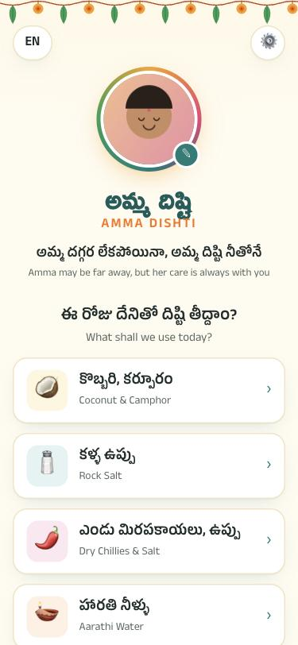
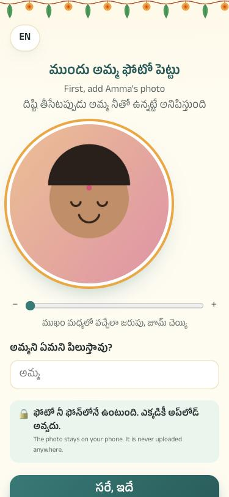
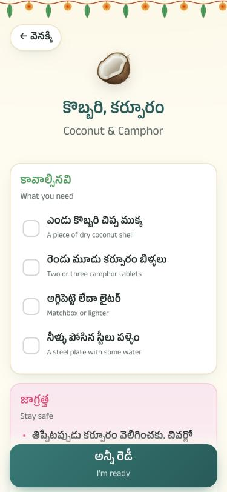
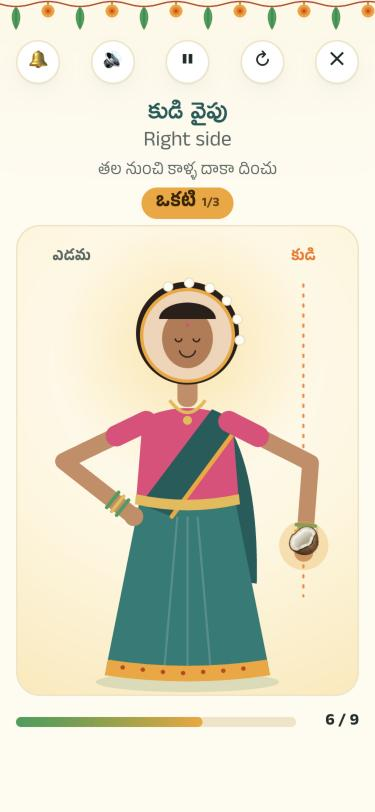
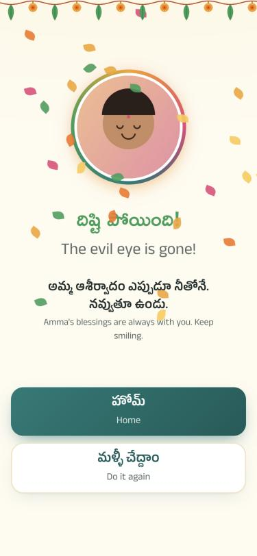

# అమ్మ దిష్టి · Amma Dishti

> **అమ్మ దగ్గర లేకపోయినా, అమ్మ దిష్టి నీతోనే.**
> Amma may be far away, but her care is always with you.

A small, warm web app for Telugu people living away from home. You upload **your mother's photo**, pick
how you want the *dishti* (evil-eye removal) done, and the app walks you through it step by step.
On screen, **Amma, with the uploaded photo as her face,** moves the item around you with her own hand, while a warm
background voice plays and the counts ring out: *ఒకటి, రెండు, మూడు*.

Everything runs in the browser. **The photo and Amma's recordings never leave the phone.** There is no server, no login and no tracking.
**No AI or robot voices are used anywhere.** Only real human recordings play.

| Home | Amma's photo | Checklist | Ritual | Done |
| :---: | :---: | :---: | :---: | :---: |
|  |  |  |  |  |

*(Screenshots use a cartoon placeholder instead of a real photo.)*

## 🔗 Live links

| What | Link |
| --- | --- |
| 🌐 **Live website** | **<https://amma-dishti.vercel.app>** |
| 📦 **GitHub repository** | <https://github.com/manideeppeyyala/amma-dishti> |
| ▲ **Vercel project** (owner only) | <https://vercel.com/manideepyadav380-9935s-projects/amma-dishti> |

Open the live website on your phone, upload Amma's photo, and tap a method. Best with the phone volume up.

---

## Table of contents

1. [Features](#1-features)
2. [How the app flows, screen by screen](#2-how-the-app-flows-screen-by-screen)
3. [Project structure, file by file](#3-project-structure-file-by-file)
4. [Run it on your computer](#4-run-it-on-your-computer)
5. [Add Amma's voice-over (the important part)](#5-add-ammas-voice-over)
6. [Put it on GitHub](#6-put-it-on-github)
7. [Host it on Vercel](#7-host-it-on-vercel)
8. [Change colours, text, methods](#8-change-colours-text-and-methods)
9. [Privacy and safety](#9-privacy-and-safety)
10. [Browser support](#10-browser-support)
11. [Troubleshooting](#11-troubleshooting)
12. [Tech notes](#12-tech-notes)
13. [The full build story: what we did and how, step by step](#13-the-full-build-story)
14. [What was tested, and how](#14-what-was-tested-and-how)
15. [Credits and licence](#15-credits-and-licence)

---

## 1. Features

| Feature | Details |
| --- | --- |
| 📷 **Mother's photo upload** | Required on first visit. Pick from the gallery or camera, drag and zoom (or pinch) to centre her face, and save. The photo is stored on the device only. |
| 🙏 **Name for Amma** | Optional. Whatever you call her (Amma, Mummy, Ammamma…). It is used on the blessing screen. |
| 🥥🧂🌶️🪔🍋 **5 methods** | Coconut & Camphor, Rock Salt, Dry Chillies & Salt, Aarathi Water, Lemon. |
| ✅ **Checklist** | Tick off the things you need before you start. |
| ⚠️ **Safety notes** | Flame, smoke alarm, chilli, knife and lime-paste warnings for each method. |
| 👩 **Amma does the dishti** | An illustrated Amma in a teal saree with a marigold border, rose blouse, gold *vaddanam* (waist belt), green and gold bangles and jasmine in her hair. **Her face is the uploaded photo.** She faces you, so her right hand is on your left. |
| 🧍 **Guided ritual** | Amma raises her hand in blessing, circles the item in front of you 3 times, sweeps your left side head-to-toe 3 times, passes the item to her other hand and sweeps your right side 3 times, holds it out for the spit step (*థూ థూ థూ*), then shows the method's last step. Her arms bend naturally at the elbow as they move (two-bone IK), and a marigold trail follows the item. |
| 🎵 **Background voice** | A cleaned-up, voice-changed recording (`audio/background.m4a`) loops softly from the moment the ritual starts. It drops in volume automatically whenever a spoken line plays, and fades out at the last step. It can be switched off in Settings. |
| 🎙️ **Amma's own voice** | The user can record Mom saying each of the 15 lines right in the app (in person or on speaker-phone), or upload her WhatsApp voice notes. Saved on the phone only. |
| 🗣️ **Default voice** | Any line Mom hasn't recorded plays the site's default human recording from `audio/`. If neither exists, the line is shown on screen without sound. **No text-to-speech or AI voice.** |
| ✨ **Voice fine-tuning** | Every clip is cleaned up on its own: silence trimmed at both ends, loudness evened out (≈ −19 dBFS), clicks removed with fades, low rumble cut (85 Hz high-pass), slight clarity lift (+2.5 dB at 2.8 kHz), and soft compression so every line sounds equally clear. |
| 🔀 **Whose voice?** | Settings → *Amma's* (Mom's clip first, then default) or *Default* (always the default voice). |
| 🔔 **Temple bell** | Generated in code (Web Audio), so it needs no sound file. Rings after each sweep. |
| ⏸ **Controls** | Bell on/off, voice on/off, pause/resume, restart, close. It pauses itself if you switch apps or lock the screen, and **carries on by itself when you come back**. |
| 🔈 **"Tap here for sound"** | Phones sometimes block or interrupt web audio (after the photo picker, a call, the microphone, or switching apps). Whenever sound should be playing but the phone has stopped it, a pink **Tap here for sound** button appears on the ritual screen. One tap anywhere brings the sound back. |
| 🌐 **Telugu ⇄ English** | Telugu first by default. One tap swaps to English first. Both languages are always visible. |
| 🐢 **Speed** | Normal or Slow (1.5× slower), set in Settings. |
| 📱 **Installable (PWA)** | "Add to Home Screen" gives it an app icon and full-screen mode. It also works offline after the first visit. |
| 💡 **Screen stays on** | Uses the Wake Lock API during the ritual where supported. |
| 🌼 **Celebration** | Falling marigold petals and a blessing with Amma's photo at the end. |

**Colour palette ("positivity" colours)**

| Token | Hex | Used for |
| --- | --- | --- |
| Peacock teal | `#0F7C77` | Main buttons, headings, the figure's clothes |
| Marigold | `#F5A524` | Photo ring, counts, "Let's begin" button |
| Saffron | `#F97316` | Accents, guide lines |
| Kumkum pink | `#E8457A` | Safety card, bindi, *థూ!* |
| Mango leaf | `#2F9E58` | Checklist ticks, "done" title |
| Turmeric cream | `#FFFBF0` | Page background |

---

## 2. How the app flows, screen by screen

```
First visit ─► #/setup  (upload + crop Amma's photo, optional name)  ─► Save
                                                                        │
              ┌─────────────────────────────────────────────────────────┘
              ▼
           #/voice/first  "Add Amma's voice?"  ─► Yes: record/upload each line
                                               └► Later: use the default voice
              ▼
           #/            Home: Amma's photo, 🎙 voice chip (x/15), 5 methods, ⚙ settings, EN/తెలుగు
              │  tap a method
              ▼
           #/m/<id>      Checklist + safety notes  ─► "I'm ready"  (voice: ready)
              ▼
           #/m/<id>/stand   "Stand in front of your phone" + what to hold ─► "Let's begin"
              ▼
           #/m/<id>/go   Ritual player
                           1. Amma arrives            (voice: welcome, bell)
                           2. Around your head  × 3   (voice: around, one/two/three)
                           3. Left side         × 3   (voice: left,   one/two/three)
                           4. Right side        × 3   (voice: right,  one/two/three)
                           5. Spit three times        (voice: spit)   — skipped for Aarathi
                           6. Last step card          (voice: finish_<id>) ─► "Done"
              ▼
           #/m/<id>/done  Petals + blessing         (voice: done, bell)
```

Method ids: `coconut`, `salt`, `chilli`, `aarathi`, `lemon`.

Routes live in the URL hash (`#/…`), so the phone's back button works and no server rewrites are needed.

---

## 3. Project structure, file by file

```
amma-dishti/
├── index.html              Page shell: fonts, manifest, <main id="app">, settings <dialog>
├── css/
│   └── styles.css          All styling. Colour tokens are at the top in :root
├── js/
│   ├── app.js              Router + every screen (home, setup, detail, stand, done, settings)
│   ├── ritual.js           The animated ritual player (SVG figure, moving photo, timing, controls)
│   ├── data.js             ALL text (Telugu + English), the 5 methods, and the voice script
│   ├── sound.js            Voice playback (Amma's clip → default clip → silent) + synthesised bell
│   ├── voicefx.js          Voice fine-tuning: trim, level, fades, rumble filter, compressor
│   ├── recorder.js         Microphone recording (MediaRecorder) with a live level meter
│   ├── voicestore.js       IndexedDB storage for Amma's recordings (on the phone only)
│   ├── cropper.js          Drag/pinch/zoom circular cropper → 480×480 JPEG
│   └── store.js            localStorage helpers (photo + settings)
├── audio/
│   ├── clips.json          Lists the default voice clips + the background voice file
│   ├── background.m4a      Background voice (made with tools/make-background.sh)
│   └── *.mp3 / *.m4a       Optional per-line default voice clips
├── tools/
│   └── make-background.sh  Clean + voice-change + level a recording → audio/background.m4a
├── icons/
│   ├── icon.svg            App icon (marigold)
│   ├── icon-192.png        Home-screen icon
│   └── icon-512.png        Home-screen icon (large)
├── docs/screenshots/       Images used in this README
├── manifest.webmanifest    PWA manifest (name, colours, icons)
├── sw.js                   Service worker: network-first with offline fallback
├── vercel.json             Vercel headers (no-cache for sw.js, security headers)
├── .gitignore
└── README.md               You are here
```

There is **no build step and no dependencies**. Plain HTML, CSS and JavaScript (ES modules).

---

## 4. Run it on your computer

You need any static file server. ES modules do **not** work from `file://`, so don't just double-click `index.html`.

**Option A: Python (already on macOS)**

```bash
cd amma-dishti
```

```bash
python3 -m http.server 5173
```

Open <http://localhost:5173>.

**Option B: Node**

```bash
npx serve .
```

**Test on your phone on the same Wi-Fi**

1. Find your computer's IP: `ipconfig getifaddr en0` (macOS).
2. Run `python3 -m http.server 5173 --bind 0.0.0.0`.
3. On the phone, open `http://<that-ip>:5173`.

> Wake Lock, the service worker and "Add to Home Screen" need **HTTPS**, so test those on the Vercel URL.

---

## 5. Add Amma's voice-over

There are **two kinds of voice**. Neither uses AI or text-to-speech.

| | Amma's own voice | Default voice |
| --- | --- | --- |
| Who records it | The **user**, with their mother | **You**, the site owner (or anyone you choose) |
| Where it's added | Inside the app: 🎙 *Amma's voice* | The `audio/` folder of this repo |
| Where it's stored | IndexedDB on that user's phone only | Your Vercel deployment, the same for everyone |
| When it plays | Always first, if that line was recorded | For any line Mom hasn't recorded |

Order for every line: **Amma's clip → default clip → no sound (the line still shows on screen)**.

### 5.1 Amma's own voice (in the app, for users)

1. After the photo, the app asks **"Add Amma's voice?"** → *Yes* or *Later, use the default voice*.
   It can be opened any time from the 🎙 chip on the home screen, or ⚙ Settings → *Amma's voice*.
2. Each of the 15 lines is shown in Telugu with its English meaning. For each line:
   - **🎙 Record**: tap, let Mom say the line, tap **⏹ Stop**. A live meter shows the level. It stops by itself at 20 s.
     This works in person or with Mom on speaker-phone.
   - **📁 File**: pick a voice note she sent (WhatsApp → long-press the voice note → Share → *Save to Files*).
     MP3, M4A, AAC, WAV, OGG and Opus are accepted (Opus/OGG need a recent browser). Up to 45 s.
   - **▶ Play**: hear the **fine-tuned** result.
   - **🗑 Remove**: delete it, and that line goes back to the default voice.
3. The badge on each line shows **Amma's voice ✓**, **Default voice**, or **Not added yet**.
4. ⚙ Settings → **Whose voice?** → *Amma's* (default) or *Default*.

The microphone needs HTTPS (Vercel gives you that) and the user's permission. `vercel.json` already allows
`microphone=(self)`.

### 5.2 Default voice (your recordings, in this repo)

Record each line below as a **separate file** in a quiet room, phone about 20 cm from your mouth.
Voice Memos (iPhone) or any recorder app is fine. No editing is needed, because the app fine-tunes every clip.

| # | File name | When it plays | What to say (Telugu) | Meaning |
| - | --- | --- | --- | --- |
| 1 | `welcome` | Start of the ritual | రా కన్నా, దిష్టి తీసేస్తాను. | Come here, dear. Let me take the evil eye off you. |
| 2 | `ready` | Tapping "I'm ready" | ఫోన్ ముందు నిలబడు కన్నా. కుడి చేతిలో పట్టుకో. | Stand in front of the phone. Hold it in your right hand. |
| 3 | `around` | Before circling the head | ముందు తల చుట్టూ మూడు సార్లు తిప్పు. | First, circle it around your head three times. |
| 4 | `left` | Before the left side | ఇప్పుడు ఎడమ వైపు, తల నుంచి కాళ్ళ దాకా. | Now the left side, from head to toe. |
| 5 | `right` | Before the right side | ఇప్పుడు కుడి వైపు. | Now the right side. |
| 6 | `one` | Count 1 | ఒకటి | One |
| 7 | `two` | Count 2 | రెండు | Two |
| 8 | `three` | Count 3 | మూడు | Three |
| 9 | `spit` | Spit step | ఇప్పుడు మూడు సార్లు ఉమ్ము. థూ, థూ, థూ. | Now spit on it three times. |
| 10 | `finish_coconut` | Last step, Coconut | కొబ్బరి ముక్కని పళ్ళెంలో పెట్టి కర్పూరం వెలిగించు… | Light the camphor on the plate… |
| 11 | `finish_salt` | Last step, Rock Salt | ఉప్పుని గ్లాసు నీళ్ళలో వేసి కరిగించు… | Dissolve the salt in water… |
| 12 | `finish_chilli` | Last step, Chillies | మిరపకాయలు, ఉప్పు పళ్ళెంలో వేసి వెలిగించు… | Burn the chillies and salt on the plate… |
| 13 | `finish_aarathi` | Last step, Aarathi | హారతి నీళ్ళని ఇంటి గుమ్మం బయట పారబొయ్యి… | Pour the water outside the front door… |
| 14 | `finish_lemon` | Last step, Lemon | నిమ్మకాయని పళ్ళెం మీద రెండు ముక్కలు చెయ్యి… | Cut the lemon in two and throw it outside… |
| 15 | `done` | Finish screen | అయిపోయింది కన్నా. దిష్టి అంతా పోయింది. హాయిగా ఉండు. | All done, dear. Be happy. |

The full text of rows 10–14 is in [`js/data.js`](js/data.js) under each method's `finish`.

**Add them:**

1. Name the files exactly as in the table, plus their extension, for example `welcome.m4a` or `welcome.mp3`.
2. Copy them into the `audio/` folder.
3. List them in `audio/clips.json`. Write a bare name for `.mp3`, or the full file name for any other format:
   ```json
   {
     "clips": ["welcome.m4a", "ready.m4a", "around", "left", "right", "one", "two", "three", "spit", "done"],
     "background": "background.m4a"
   }
   ```
4. Commit and push (section 6). Vercel redeploys on its own.

You don't need all 15. Missing lines simply play without sound and keep their on-screen text.

**One long recording?** Cut it into clips with [ffmpeg](https://ffmpeg.org) (`brew install ffmpeg`):

```bash
ffmpeg -i full.m4a -ss 00:00:01.2 -to 00:00:03.8 -c:a aac -b:a 96k welcome.m4a
```

### 5.3 Background voice (plays during the whole dishti)

`audio/background.m4a` is a longer recording that loops softly under the ritual, so there is always a warm voice while
Amma does the dishti. It is made from a raw recording with one command:

```bash
brew install ffmpeg rubberband
```

```bash
tools/make-background.sh "/path/to/WhatsApp Audio.opus"
```

What the script does, step by step:

| Step | Tool / filter | Setting | Why |
| --- | --- | --- | --- |
| 1. Clean | `highpass` | 80 Hz | Removes rumble and handling noise |
| | `afftdn` | noise floor −28 dB, 12 dB reduction | Removes steady background hiss |
| | `deesser` | 0.35 | Softens sharp "s" sounds from WhatsApp compression |
| 2. Change the voice | `rubberband` (R3 engine) | **+2 semitones**, **1.04× tempo** | A brighter, livelier voice that doesn't sound like the original speaker |
| 3. Brighten | `equalizer` | −2.5 dB at 300 Hz, +3 dB at 3 kHz, +2 dB shelf above 6.5 kHz | Less muddy, clearer words |
| | `acompressor` | 2.5:1 from −20 dB | Steady, easy-to-hear level |
| | `aecho` | 35/55 ms, very low | A touch of room warmth |
| 4. Level | `loudnorm` | −16 LUFS, −1.5 dBTP | Same loudness on every phone |
| | `afade` | 0.4 s in / 0.9 s out | Smooth start and loop |

Tweak the voice change with environment variables:

```bash
PITCH=3 TEMPO=1.06 tools/make-background.sh recording.opus
```

`PITCH=0 TEMPO=1` keeps the original voice; `PITCH=3` or more makes it very different.

The current file was measured before and after processing: median pitch went from **200 Hz to 225 Hz**, and brightness
(spectral centroid) went from **754 Hz to 1018 Hz**. Loudness is −16.0 LUFS with peaks at −1.6 dBFS. The file is 50 s long.

In the app the background voice fades in over 1.5 s, plays at full level (it is already normalised to −16 LUFS), drops to
30 % while a spoken line plays, loops with a 1.2 s pause, and fades out over 1.2 s when the last-step card appears.
Settings → *Background voice during dishti* turns it off. The 🔊 button on the ritual screen mutes it together with the spoken lines.

### 5.4 What "fine-tuning" does (per-line clips)

Defined in [`js/voicefx.js`](js/voicefx.js). It runs on every clip, Mom's and the default ones alike, every time one is loaded:

| Step | What | Why |
| --- | --- | --- |
| 1 | Mix to mono | Phone speakers are mono anyway |
| 2 | Trim silence (10 ms windows, gate at 10 % of the loudest part, keeps 60 ms before / 180 ms after) | No awkward pauses before Amma speaks |
| 3 | Even out loudness (target ≈ −19 dBFS speech level, peak ceiling −0.7 dBFS, max 10× boost) | Quiet WhatsApp notes and loud recordings sound the same |
| 4 | 12 ms fade-in, 60 ms fade-out | No clicks |
| 5 | 85 Hz high-pass | Removes fan, traffic and handling rumble |
| 6 | +2.5 dB at 2.8 kHz | Clearer Telugu consonants on small speakers |
| 7 | Soft compressor (3:1 from −22 dB) | Every word is easy to hear |

Recordings made in the app also use the phone's own **echo cancellation, noise suppression and auto-gain**.

## 6. Put it on GitHub

**Where it lives:** <https://github.com/manideeppeyyala/amma-dishti> (public, branch `main`).

**How it was done** (GitHub CLI, from inside the `amma-dishti` folder):

1. Sign in once. This opens the browser, shows a one-time code and asks you to approve:
   ```bash
   gh auth login --hostname github.com --git-protocol https --web
   ```
2. Create the local repository and set the author for this repo only. The address is GitHub's private "noreply"
   address, so no personal email is published:
   ```bash
   git init -b main
   ```
   ```bash
   git config user.name "PEYYALA MANIDEEP"
   ```
   ```bash
   git config user.email "145202682+manideeppeyyala@users.noreply.github.com"
   ```
3. Commit everything:
   ```bash
   git add -A && git commit -m "Amma Dishti: guided dishti with Amma's photo and voice"
   ```
4. Create the public repository on GitHub and push in one step:
   ```bash
   gh repo create amma-dishti --public --source=. --remote=origin --push
   ```
5. Add the description, website link and topics shown on the repository page:
   ```bash
   gh repo edit --homepage https://amma-dishti.vercel.app --add-topic telugu,pwa,web-audio,vanilla-js
   ```

**Later changes:**

```bash
git add -A && git commit -m "Describe the change" && git push
```

`.gitignore` keeps `.DS_Store`, `.vercel/`, `node_modules/` and log files out of the repository.

---

## 7. Host it on Vercel

**Where it lives:** <https://amma-dishti.vercel.app> (project `amma-dishti`, Hobby plan, account `manideepyadav380-9935`).

**How it was done** (Vercel CLI; no build step, because the site is plain static files):

1. Sign in once. It prints a link with a one-time code; open it and click **Allow**:
   ```bash
   npx vercel login
   ```
2. Deploy to production from the project folder. `--yes` accepts the defaults: a new project named after the folder,
   framework "Other", no build command, output directory `.`:
   ```bash
   npx vercel deploy --prod --yes
   ```
   The CLI creates a `.vercel/` folder that remembers which project this folder belongs to (it is git-ignored).
3. Connect the GitHub repository so that **every push to `main` redeploys automatically**:
   ```bash
   npx vercel git connect https://github.com/manideeppeyyala/amma-dishti
   ```
   **Status: connected on 10 October 2026.** A push to `main` now builds and publishes by itself in well under a minute.

   If the CLI says Vercel has no access to the repository, open the project in the Vercel dashboard →
   **Settings → Git → Connect Git Repository**, choose GitHub, install the Vercel GitHub app for the
   `manideeppeyyala` account and pick `amma-dishti`. Until that is done, deploy by hand with the command in step 2.

**What `vercel.json` sets:**

| Setting | Value | Why |
| --- | --- | --- |
| `cleanUrls` | `true` | `/index.html` redirects to `/` |
| `/sw.js` header | `Cache-Control: no-cache` | Phones always check for a new service worker |
| `/audio/*` header | `Cache-Control: public, max-age=3600` | Voice files are cached for an hour |
| `Permissions-Policy` | `camera=(), microphone=(self), geolocation=()` | Only this site may use the microphone; camera and location are switched off |
| `X-Content-Type-Options` | `nosniff` | Standard hardening |
| `Referrer-Policy` | `strict-origin-when-cross-origin` | Standard hardening |

**Start from scratch on another account (dashboard way):** go to <https://vercel.com/new>, sign in with GitHub,
import the repository, choose Framework Preset **Other**, leave Build Command, Output Directory and Install Command
empty, and click **Deploy**.

### Custom domain (optional)

In Vercel, open **Project → Settings → Domains**, add your domain and follow the DNS instructions shown there.

---

## 8. Change colours, text and methods

**Colours:** edit the tokens at the top of [`css/styles.css`](css/styles.css):

```css
:root {
  --teal: #0f7c77;      /* main colour */
  --marigold: #f5a524;  /* highlight */
  --rose: #e8457a;      /* warnings, bindi */
  --leaf: #2f9e58;      /* success */
  --bg: #fffbf0;        /* background */
}
```

Also update `theme-color` in `index.html` and `theme_color` in `manifest.webmanifest`.

**Text:** every word on screen is in [`js/data.js`](js/data.js) as `{ te: '…', en: '…' }`.

**Add a method:** copy one object in `METHODS` inside `js/data.js`, give it a new `id`, `emoji`, `name`, `holding`,
`items`, `safety`, `spit` (true/false) and `finish`. Then add `finish_<id>` to `VOICE_SCRIPT` at the bottom of the same file.

**Timing:** in [`js/ritual.js`](js/ritual.js), search for `3000` (one circle, ms) and `2600` (one side sweep, ms).

**Loudness:** in [`js/sound.js`](js/sound.js), `BG_LEVEL` (background voice, 1.0) and `BG_DUCKED` (while a line plays, 0.3);
the bell's level is `0.2 * strength` in `ring()`.

**Cache:** after big changes, bump `VERSION` in `sw.js` (currently `amma-dishti-v4`) so installed phones fetch the new files.

---

## 9. Privacy and safety

- The photo is cropped and resized **in the browser**, then saved in the browser's `localStorage` on that phone.
  It is never uploaded. The app has no backend.
- Amma's recordings are saved in the browser's **IndexedDB** on that phone. They are never uploaded either.
- The microphone is used only while 🎙 Record is active on the *Amma's voice* screen.
- "Erase everything" in Settings deletes the photo, Amma's recordings and all settings from the phone.
- No AI or text-to-speech voices. Only real recordings are played.
- The only external requests are Google Fonts and your own Vercel domain.
- Every method shows safety notes. The coconut method tells you to **circle it unlit** and light it only once it rests on the plate.

---

## 10. Browser support

| Browser | Status |
| --- | --- |
| Chrome / Edge (Android, desktop) | ✅ Full |
| Safari (iPhone/iPad, iOS 15.4+) | ✅ Full. Wake Lock needs iOS 16.4+ |
| Firefox | ✅ Works. Wake Lock is not supported, so keep the screen awake manually |
| Samsung Internet | ✅ |

In-app recording needs HTTPS and microphone permission (Chrome 49+, Safari 14.1+, Firefox 25+).
Uploaded voice notes in OGG/Opus format need Safari 17+ on iPhone; MP3, M4A, AAC and WAV work everywhere.

---

## 11. Troubleshooting

| Problem | Fix |
| --- | --- |
| Blank page locally | You opened `index.html` directly. Use a local server (section 4). |
| No sound | 1. Turn the phone's **media volume** up. 2. If a pink **Tap here for sound** button shows on the ritual screen, tap it. 3. Check that 🔊 and 🔔 at the top of the ritual screen are not dimmed, and that *Play voice* and *Background voice during dishti* are on in ⚙ Settings. 4. Close other apps that are playing audio or using the microphone. 5. On an old iPhone (iOS below 16.4), switch the side silent switch off. |
| Sound stops after a call or after switching apps | Tap once anywhere on the page. Every tap re-starts the audio engine. |
| It says "Paused" | Tap ▶ at the top or tap the picture. It pauses itself when the page is hidden and resumes when you return. |
| Default clip doesn't play | Check that the name is exact and lowercase, that it is listed in `audio/clips.json`, and that it was pushed. |
| "Microphone access was blocked" | iPhone: Settings → Safari → Microphone → Allow. Android Chrome: tap the 🔒 by the address → Permissions → Microphone. Or upload a file with 📁. |
| "Couldn't open that file" | WhatsApp `.opus` notes need a recent browser. Convert to M4A or MP3, or record in the app instead. |
| Amma's clip sounds quiet or too loud | Re-record it closer to or further from the phone. Fine-tuning levels it, but it can't fix heavy distortion. |
| Old version still showing | Pull to refresh twice, or bump `VERSION` in `sw.js` and redeploy. |
| Photo looks rotated | Re-pick the photo, or take a screenshot of it and upload that instead. |
| Want to change the photo | Tap Amma's photo on the home screen, or use ⚙ → Pick another. |

---

## 12. Tech notes

- **Zero dependencies, zero build.** Static files only, which suits Vercel's static hosting perfectly.
- **Voice through Web Audio:** clips are decoded into an `AudioContext` that is unlocked on the first tap, so iPhones play later cues without another tap.
  Each clip is fine-tuned once when decoded, cached, and played through the filter and compressor chain.
- **One master bus:** voice chain, background voice and bell all feed a master gain → limiter (−3 dB, 20:1) → speaker, so
  loud moments never clip. An `AnalyserNode` on the master bus powers `audioState()`, which reports the context state
  and the real output level. That is how sound was verified by measurement.
- **Interruption-proof audio:** any tap or key press anywhere calls `unlockAudio()`, which resumes the context whenever
  its state is not `running` (iPhones report `interrupted` after the photo picker, the microphone, a call or an app switch).
  While the microphone is recording, the iPhone audio session is switched to `play-and-record` and back to `playback` after.
- **Storage:** Amma's raw recordings are kept untouched in IndexedDB, so any future improvement to fine-tuning applies to clips already saved.
  `navigator.audioSession.type = 'playback'` lets the voice play even with the silent switch on (Safari 16.4+).
- **Pause-aware timeline:** `ritual.js` runs an async sequence where every wait and animation only advances while not paused.
  Restart and close bump a token that cancels the old run.
- **Accessibility:** large tap targets (≥44 px), `aria-live` phase updates, labelled controls, and `prefers-reduced-motion` support.

---

## 13. The full build story

Everything that was done, in order, and how. Built between **7 and 10 October 2026**.

### Step 0: The idea

The concept comes from the Telugu home tradition of *dishti teeyadam* (removing the evil eye), and from an existing web
app built around the same idea (`amma-dishti.pages.dev`), which was studied only to understand the flow: choose a method →
checklist → stand in front of the phone → follow Amma. **Nothing was copied from it.** Every line of code, every Telugu
and English sentence, the Amma illustration, the icon, the colour palette and the audio in this repository were made for
this project.

Decisions made at the start:

| Decision | Choice | Reason |
| --- | --- | --- |
| Tech | Plain HTML + CSS + JavaScript ES modules, no framework, no build | Loads fast on any phone, deploys anywhere as static files, nothing to maintain |
| Routing | URL hash (`#/m/salt/go`) | The phone's back button works; no server rewrites |
| Language | Telugu first with English underneath, switchable | Readable by children who speak Telugu but read English more easily |
| Storage | `localStorage` (photo, settings), IndexedDB (voice) | No server, so nothing personal ever leaves the phone |
| Colours | Peacock teal, marigold, kumkum pink, mango-leaf green on turmeric cream | The requested "positivity" palette |

### Step 1: The base site

- `index.html` shell with the fonts *Anek Telugu* (text) and *Ramabhadra* (titles) from Google Fonts.
- A mango-leaf and marigold *toranam* strip across the top of every page, drawn as an inline SVG background in CSS.
- `js/data.js` holds every word on screen as `{ te, en }` pairs, plus the 5 methods (items, safety notes, last step).
- `js/app.js`: a small hash router and one function per screen (home, photo setup, checklist, stand, done, settings sheet).
- `js/store.js`: safe wrappers around `localStorage`.
- PWA files: `manifest.webmanifest`, a marigold icon (`icons/icon.svg`, rendered to 192 px and 512 px PNG with macOS
  `qlmanage` and `sips`), and `sw.js` (network-first with an offline fallback).

### Step 2: Mother's photo upload (required)

- First visit always lands on `#/setup`. Nothing else opens until a photo is saved.
- `js/cropper.js` is a hand-written circular cropper: drag to move, slider / pinch / mouse wheel to zoom, clamped so the
  circle is always filled. It exports a 480 × 480 JPEG (quality 0.86, roughly 40–60 KB) that fits in `localStorage`.
- Optional name field ("What do you call her?") used on the blessing screen.

### Step 3: The guided ritual (first version)

- `js/ritual.js`: an async timeline where every wait and animation is pause-aware and cancellable (a run token is bumped
  on restart or close).
- Sequence: around ×3 → left ×3 → right ×3 → spit ×3 (skipped for Aarathi) → last-step card → Done.
- The first version showed a mirror figure of *you* with Amma's photo as a small badge carrying the item. It was replaced in Step 6.
- A temple bell synthesised in code (four sine partials at 660 Hz × 1, 2.32, 4.07, 6.21 with exponential decay), so no sound file is needed.
- Screen Wake Lock so the phone doesn't sleep mid-ritual.

### Step 4: Amma's own voice, and no AI voices

- New screen `#/voice`: all 15 lines with **🎙 Record**, **📁 File**, **▶ Play**, **🗑 Remove** and a status badge each.
- `js/recorder.js`: `MediaRecorder` with echo cancellation, noise suppression and auto-gain, a live level meter and a 20 s limit.
- `js/voicestore.js`: recordings saved as raw bytes in IndexedDB (database `amma-dishti`, store `voice`).
- The phone's text-to-speech fallback from the first version was **removed completely**. Only real recordings play:
  Amma's clip → the site's default clip → no sound (the line still shows on screen).
- After the photo, the app asks once: "Add Amma's voice?" → *Yes* / *Later, use the default voice*.

### Step 5: Voice fine-tuning

- `js/voicefx.js` cleans every clip when it is decoded: mono mix → silence trim → loudness levelling → fades, then plays it
  through a rumble filter, a clarity lift and a soft compressor (full table in section 5.4).
- Bad uploads are rejected with a friendly message: silent clips, files that are not audio, clips over 45 s.

### Step 6: Amma does the dishti, with the uploaded face

- The mirror figure was replaced by an original illustrated **Amma**: teal saree with pleats and a marigold border, rose
  blouse, darker pallu with a marigold edge, gold *vaddanam* and necklace, green and gold bangles, a half-crown of jasmine.
- **Her face is the uploaded photo**, clipped to a circle inside the SVG.
- Her arms are solved every frame with **two-bone inverse kinematics** (shoulder → elbow → hand, 82 and 80 units long),
  so the elbow bends naturally wherever the hand goes. The elbow always picks the outward, lower solution.
- She raises her hand in blessing, circles the item in front of you, sweeps your left side with her right hand, passes
  the item to her other hand for your right side, and holds it out for the spit step. A marigold trail follows the item,
  and she breathes gently (a 3.6 s CSS animation that stops when paused).

### Step 7: The background voice

- A 52-second family recording (WhatsApp `.opus`, 16 kHz mono) was turned into `audio/background.m4a` with
  `tools/make-background.sh` (ffmpeg + rubberband): clean → pitch +2 semitones and 4 % faster → brighten → level.
  Full settings are in section 5.3.
- Measured before → after: median pitch **200 Hz → 225 Hz**, brightness **754 Hz → 1018 Hz**, loudness **−18.6 → −16.0 LUFS**,
  peak −1.6 dBFS, length 52.2 s → 50.3 s, size 716 KB (AAC 112 kbps mono, 44.1 kHz).
- In the app it loops under the whole ritual and ducks under spoken lines.

### Step 8: First deployment

- Deployed with the Vercel CLI on 7 October 2026 to <https://amma-dishti.vercel.app>.
- Every live file was downloaded again with `curl` and compared byte-for-byte with the local, tested files (`cmp`). All matched.

### Step 9: "No audio" bug hunt

The report was: no sound during the dishti. An output meter was added to the app (`audioState()`), and the ritual was
re-run with **real taps** (scripted clicks do not unlock browser audio, which had hidden the problem in earlier tests).
Four causes were found and fixed:

| # | Cause | Fix |
| --- | --- | --- |
| 1 | The ritual pauses itself when the page is hidden, but it **never resumed** when the page came back, leaving it silent and stuck on "Paused" | Auto-pause now remembers it was automatic and resumes on return |
| 2 | Audio was only resumed from the `suspended` state. iPhones report `interrupted` after the photo picker, the mic, a call or an app switch, so sound stayed off for the whole session | Resume whenever the state is anything other than `running`, on every tap anywhere on the page |
| 3 | The background voice played at 60 % of an already modest level, which is too quiet for a phone speaker | Now plays at 100 % (30 % under spoken lines), with a limiter on the master bus so nothing clips |
| 4 | Recording with the mic while the iPhone audio session was `playback` | Session switches to `play-and-record` while recording, then back |

Plus a safety net: the pink **Tap here for sound** button whenever audio should be playing and is not.

Result after the fixes, measured over a full ritual: the audio engine stayed `running`, the output level read between
0.01 and 0.22 on every one of the 9 sweeps, the background voice stopped at the last step as designed, and after the page
was hidden and shown again the ritual and the sound resumed without a tap.

### Step 10: GitHub and automatic deploys

- Repository created with the GitHub CLI and pushed (section 6).
- Redeployed to Vercel and connected to the repository (section 7).

---

## 14. What was tested, and how

Tested in a Chromium browser at a phone-sized viewport (375 × 812), driving the app with real clicks.

| Area | What was checked | Result |
| --- | --- | --- |
| Photo | Upload, drag, zoom, save, shows on home and as Amma's face | ✅ |
| First-run flow | Photo → "Add Amma's voice?" → home | ✅ |
| All screens | Home, checklist, stand, ritual, last step, done, settings, English mode | ✅ |
| Ritual | Full run of Coconut and Rock Salt: 9 sweeps, hand-over between hands, spit step, last step, done | ✅ |
| Voice upload | A quiet 3.7 s clip padded with silence → trimmed to 1.44 s and raised about 3× | ✅ |
| Voice errors | Silent clip, non-audio file, 50 s clip → each rejected with its own message, nothing saved | ✅ |
| Background voice | Fetched, decoded (50.2 s), playing, ducking, stopping at the last step | ✅ measured |
| Sound output | Engine `running`, output level 0.01–0.22 through the ritual | ✅ measured |
| Auto pause / resume | Page hidden → paused; shown again → resumes with sound | ✅ |
| Console | No JavaScript errors | ✅ |
| Deployment | Live files byte-identical to the tested local files; HTTPS; microphone policy header present | ✅ |

**Not tested here, please check on real phones:**

- Sound on an actual iPhone and an actual Android phone (speaker volume, silent switch, Bluetooth).
- Live microphone recording (needs a real microphone and the permission prompt).
- "Add to Home Screen" and offline use.

---

## 15. Credits and licence

- Idea: the Telugu tradition of *dishti*, and the concept of the earlier app at `amma-dishti.pages.dev`. No code, text,
  artwork or audio from that app is used here.
- Code, wording, illustrations and icon: made for this project.
- Background voice: a family recording supplied by the project owner, processed with ffmpeg and rubberband.
- Fonts: [Anek Telugu](https://fonts.google.com/specimen/Anek+Telugu) and
  [Ramabhadra](https://fonts.google.com/specimen/Ramabhadra) (SIL Open Font License), loaded from Google Fonts.
- Tools used to build it: Claude Code, ffmpeg, rubberband, GitHub CLI, Vercel CLI.

No licence file is included yet, which means all rights are reserved by the owner. Add a `LICENSE` file (MIT is a common
choice) if you want others to reuse the code.

---

## Links again

- 🌐 Live website: <https://amma-dishti.vercel.app>
- 📦 Source code: <https://github.com/manideeppeyyala/amma-dishti>
- ▲ Vercel project: <https://vercel.com/manideepyadav380-9935s-projects/amma-dishti>

Made with ❤️ for every child who misses Amma's దిష్టి.
